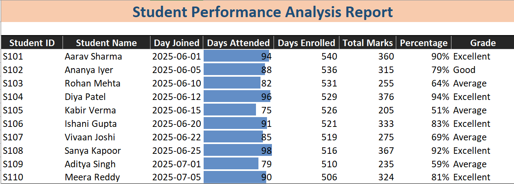
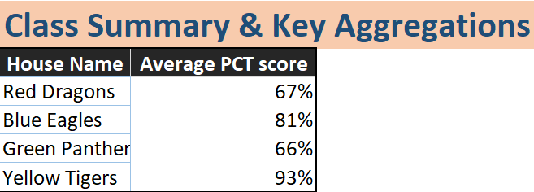
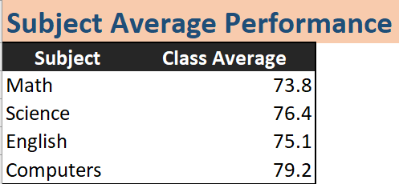
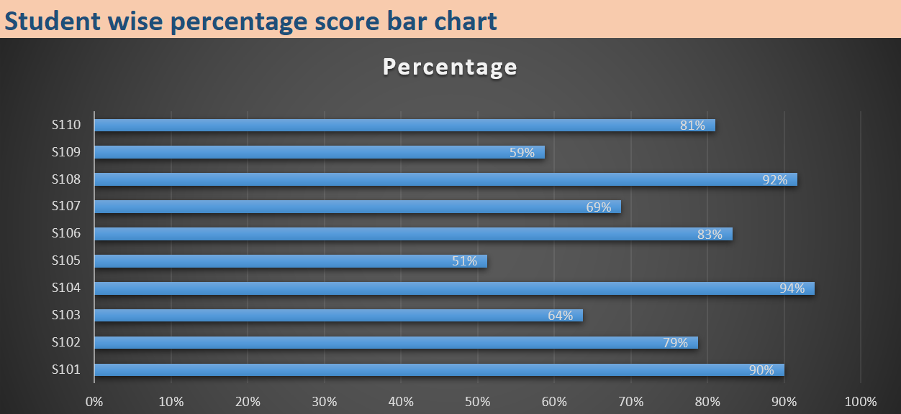

# Student Performance Analysis | Microsoft Excel

## Project Overview
This project analyzes student academic performance using Microsoft Excel. It demonstrates the use of Excel formulas, lookup functions, summary calculations, conditional formatting, and data visualization to create a structured student performance report.

The analysis covers 10 student records across four subjects, with individual percentage scores, grade classifications, house-wise performance comparisons, and subject-wise averages.

## Project Objectives
- Calculate total marks, percentages, and student grades.
- Track student attendance and enrollment information.
- Compare average percentage scores across student houses.
- Analyze class performance across four subjects.
- Visualize student-wise percentage scores.
- Present academic performance in an easy-to-understand report.

## Tools and Techniques
- Microsoft Excel
- Excel formulas and lookup functions
- Percentage and grade calculations
- AVERAGEIF and other summary calculations
- Conditional formatting with data bars
- Horizontal bar chart
- Data formatting and reporting

## Dataset Overview
- Students: 10
- Subjects: Math, Science, English, Computers
- Data fields include student identifiers, names, joining dates, attendance, marks, and house information.

## Project Screenshots

### 1. Student Performance Report

### 2. House Performance Analysis

### 3. Subject Average Performance

### 4. Student-wise Percentage Score Chart

## Key Insights
- Yellow Tigers achieved the highest house-wise average percentage score at 93%.
- Green Panthers recorded the lowest house-wise average at 66%.
- Computers had the highest subject average at 79.2 marks.
- Math had the lowest subject average at 73.8 marks.
- Student S104 achieved the highest individual percentage score at 94%.
- Student S105 recorded the lowest individual percentage score at 51%.

## How to View the Project
1. Download [Student_Performance_Analysis.xlsx](Student_Performance_Analysis.xlsx).
2. Open the workbook in Microsoft Excel.
3. Review the Data sheet for the underlying student records.
4. Explore the Report sheet for performance calculations, summaries, and charts.

## Project Files
- `Student_Performance_Analysis.xlsx` — Excel workbook
- `screenshots/` — Report and chart screenshots

## Skills Demonstrated
Excel reporting, data analysis, lookup formulas, conditional formatting, aggregation, performance comparison, and data visualization.

## Future Improvements
- Add a clear report date and attendance-period definition.
- Improve formula robustness using exact-match lookups.
- Expand the dataset for deeper performance analysis.
